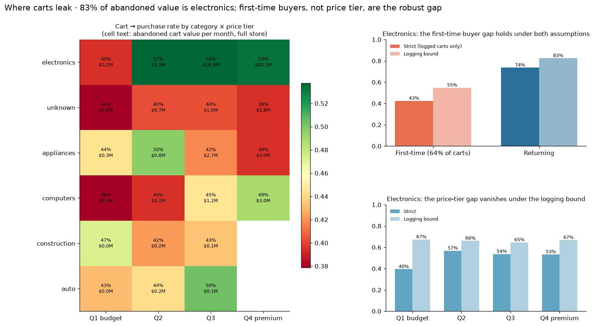
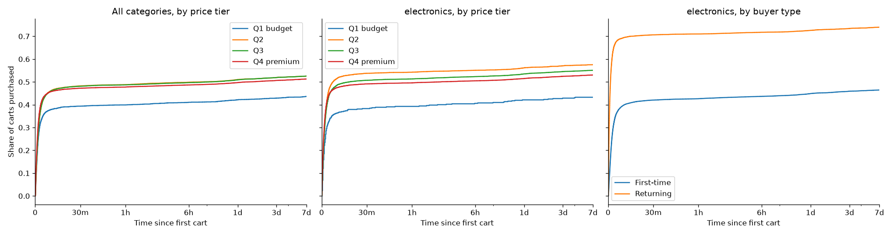
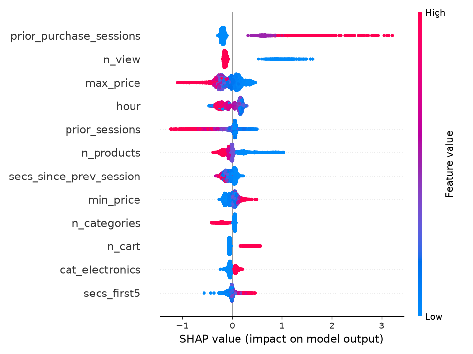
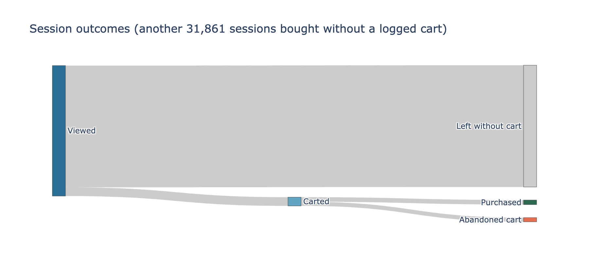
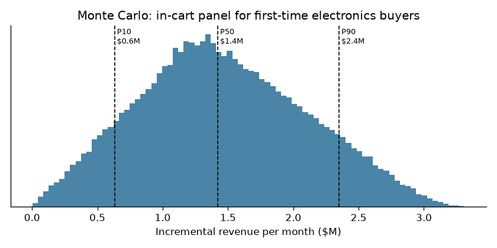

# First-Time Buyers, Not Premium Prices, Drive Cart Abandonment in Electronics

I analyzed 4.2M October 2019 events from a multi-category online store. In electronics, which holds 83% of abandoned cart value, first-time buyers convert from cart at 43% against 74% for returning buyers. The 28–31 point gap holds under every robustness check, while the obvious explanation, premium prices, does not. I recommend a 2-week A/B test of an in-cart reassurance panel for first-time electronics buyers. Each point of conversion it adds is worth about $1.0M a month.

**Live dashboard:** [Tableau Public](https://public.tableau.com/app/profile/rebecca.yanni/viz/CartAbandonmentFunnel/Dashboard1) (source: [outputs/tableau_funnel.csv](outputs/tableau_funnel.csv)) | **Summary:** [SUMMARY.md](SUMMARY.md)

## Business question
Which product categories and price tiers lose the most shoppers between cart and purchase, how much revenue is that worth, and what should a team test first?

## Data
REES46 eCommerce behavior data ([Kaggle](https://www.kaggle.com/datasets/mkechinov/ecommerce-behavior-data-from-multi-category-store)), October 2019: 42,448,764 events, 3,022,290 users. Analysis uses a 10% random user sample (all events of each sampled user, `hash(user_id) % 10 = 0`) to fit an 8 GB laptop: 4,231,663 clean events from 302,351 users. Raw data is not included; see the Kaggle page for the license.

## Key findings
1. **Electronics is where the money leaks.** It holds 83% of abandoned cart value, about $82M of $99M a month store-wide. Premium electronics alone is $60M, but that's mostly because premium carts cost more. Measured against the best-converting tier in each category, its excess loss is about $4.5M a month.
2. **Price tier doesn't hold up as a lever.** Premium electronics seems to convert 3.5 points below mid-priced (Q2), but two checks undo that.
   - **Category mix:** across categories, premium ranks first pooled and below Q2 and Q3 once the mix is held fixed (Simpson's paradox).
   - **Cart logging:** premium buyers more often purchase with no logged cart (43% vs 33%). If those purchases had unlogged carts, premium converts 0.7 points *above* Q2.
3. **First-time buyers are the robust gap.** In electronics, 64% of carts come from users with no earlier purchase. Their carts convert at 42.5%, against 73.6% for returning buyers. The gap survives every check:
   - **Logging bound:** 54.8% vs 82.5%.
   - **Every price tier:** a gap of 26–32 points.
   - **Outside electronics:** 28 points.
   - **Over 7 days:** 46.5% vs 74.0% (Kaplan-Meier, log-rank p < 1e-100).
4. **The decision happens within minutes.** Of carts bought within 7 days, 81% were bought within 5 minutes and 92% within 30 (median 1.75 minutes). Only 0.6% were bought within 10 seconds, so this isn't an artifact of carts and purchases logged together. Only 2.9% were bought after a day. Anything meant to change the outcome has to happen in the session, not in a reminder email.

## What I checked and dropped
I first framed this project around premium electronics: "$60M of abandoned carts." That number mostly reflects price, and the conversion gap behind it didn't survive the cart-logging bound (finding 2). I kept the analysis because it shows why the headline changed. The recommendation targets the gap that held up.

## Method
- **Sessionization (SQL, DuckDB):** a new session starts after 30 minutes of inactivity. Sensitivity: 10 / 30 / 60 minutes gave 840,984 / 779,252 / 752,293 sessions and did not change the conclusions. The overall cart-to-purchase rate moved from 49.6% to 50.8%, and the ranking of the 8 categories with 100 or more carts was identical (Spearman ρ = 1.0).
- **Funnel definition:** a session reaches Cart only after a View, and Purchase only after a Cart, in that order (per product). 55.9% of purchased session-products have no earlier cart in the same session. Every rate gap is therefore reported two ways:
  - **Strict:** only logged carts count.
  - **Logging bound:** every no-cart purchase is treated as if it had an unlogged cart.

  The true rate lies between the two.
- **Segmentation:** top-level category × price tier (quartiles of average product price within each category) × first-time vs returning buyer. A buyer counts as returning after a purchase earlier in October. Simpson's paradox check: found for price tier (Q4 vs Q2 and Q3 flip after mix adjustment).
- **Survival analysis:** Kaplan-Meier time from a user's first cart of a product to purchasing it, in any session, with a 7-day horizon, by price tier and by buyer type. Carts are censored at 7 days or at the end of the data.
- **Prediction:** XGBoost on a session's first 5 events plus the user's earlier sessions. The model covers 209,302 sessions with 6 or more events. Split by time: train Oct 1–17, validation Oct 18–21, test Oct 22–31. SHAP explains the predictions.
  - **Test set:** PR-AUC 0.386 against a 0.099 base rate (ROC-AUC 0.785). Precision in the top decile is 40.9%, a 4.1× lift.
  - **Two uses:** the model's top feature (earlier purchases) independently backs finding 3. Within the experiment's population, the model's score splits sessions into low, middle and high terciles that buy at 3.4% / 5.9% / 20.3%. Those terciles are the strata for a pre-registered check of where the panel helps most.
- **Experiment design:** power analysis and test plan for the in-cart panel.
- **Impact sizing:** value per point of lift, low / base / high scenarios, and a 100,000-draw Monte Carlo range.

## Results
| | |
|---|---|
|  |  |
|  |  |

- **Survival:** curves flatten within about 15 minutes for every group. The first-time vs returning gap (right panel) is much wider than any gap between price tiers (middle panel).
- **SHAP:** the strongest signal is a purchase in an earlier session. A cart within the first 5 events (seen as fewer views) also pushes predictions up. Higher prices push them down, and a long browsing history without buying lowers the odds.
- **Session funnel:** of 779,252 sessions, 6.7% cart after a view and 52% of those buy after the cart. Another 31,861 sessions buy with no logged cart.

## Recommendation and experiment plan
- **Hypothesis:** returning buyers already trust the store and have checkout details saved, and first-time buyers have neither. The data shows *who* abandons, not *why*, so this test is how to find out.
- **Intervention:** for first-time buyers with an electronics product in the cart, show a panel in the cart and at checkout. It gives the expected delivery date, the returns policy and payment options, including installments.
- **Randomization:** by user, 50/50, among users with no earlier purchase. Analyze per cart with standard errors clustered by user.
- **Primary metric:** share of carts purchased within 7 days. The baseline is 46.5%.
- **Guardrails:** average order value, cancellations and returns within 30 days, conversion of returning buyers (to catch spillover), and checkout page load time.
- **Sample size:** to detect +1.0 percentage point (2.2% relative) with α = 0.05 (two-sided) and 80% power, you need 39,097 carts per arm. +1.5 points needs 17,386 per arm.
- **Duration:** about 57,000 eligible carts a week store-wide, so 2 full weeks, to cover weekly cycles. Fix the duration before launch and don't stop early.
- **Decision rule:** ship if the lower bound of the 95% CI on lift is above 0 and no guardrail worsens by more than its preset threshold (for example, +1 percentage point in cancellations). Pre-registered secondary analysis: lift by model-score tercile.
- **If it wins:** test the delivery-date, returns and installments components separately to find which one drives the lift. **If it's flat:** the gap is probably who the shoppers are rather than checkout friction, and the next test should target the checkout flow itself (guest checkout).

## Impact estimate
There are about 253,000 first-time electronics carts a month store-wide, with a $398 average cart price. **Each +1 point of 7-day conversion is worth about $1.0M a month in revenue.**

The Monte Carlo assumes:
- **Lift:** the panel closes a small share of the conservative 27.7-point gap (triangular 0 / 5% / 12%). Most of the gap is likely who the shoppers are, which no message can change.
- **Reach:** 85–100% of carts render the panel (uniform).
- **Margin:** triangular 8 / 15 / 22%.

Under these assumptions, the median lift is +1.5 points and incremental revenue is **$1.42M a month at the median**, with a P10–P90 range of $0.63M–$2.35M. Gross profit is $208K a month (P10–P90: $89K–$366K). The fixed scenarios give $0.47M (low), $1.29M (base) and $2.79M (high). The lift range is an assumption, not a measurement, and the test replaces it with a real number.

## Data quality log
| Check | Rows (10% sample) | Action |
|---|---:|---|
| Sampled rows | 4,241,074 | kept |
| Exact duplicate events | 2,963 | dropped |
| Price ≤ 0 or missing | 6,448 | dropped |
| Unknown event type | 0 | — |
| Missing category_code | 1,347,268 | kept, labeled "unknown" |
| Missing brand | 609,025 | kept |
| Missing user_session | 0 | sessions rebuilt from gaps anyway |
| Events outside October | 0 | — |
| Purchases with no earlier cart in session | 55.9% of purchases | every rate gap reported strict and with a logging bound |
| Clean events | 4,231,663 | analysis table |

## Limitations
- One store, October 2019, 10% user sample; results may not generalize
- Revenue figures rest on stated assumptions (reach, lift, margin, cost)
- The model shows association, not causation, and so does the first-time buyer gap. Returning buyers are partly selected for being buyers, so only a small share of the gap is assumed closable.
- "First-time" means no purchase earlier in October. Buyers from before October are counted as first-time, which makes the measured gap smaller than the true one (left-censoring).
- Carts from the last week of October have less than 7 days of follow-up (handled by right-censoring)
- The "unknown" category (32% of events) has no category code and is kept as its own group

## How to reproduce
1. Download `2019-Oct.csv.gz` into data/raw/ (Kaggle, or `https://data.rees46.com/datasets/marketplace/2019-Oct.csv.gz`)
2. pip install -r requirements.txt
3. `python run_sql.py` runs the SQL files in sql/ in numeric order with DuckDB (about 1 minute) and writes `data/processed/funnel.duckdb`
4. Run the notebooks in notebooks/ in numeric order. Each one adds its numbers to `outputs/results.json`, and every figure in this README comes from them. Results are deterministic across runs.
